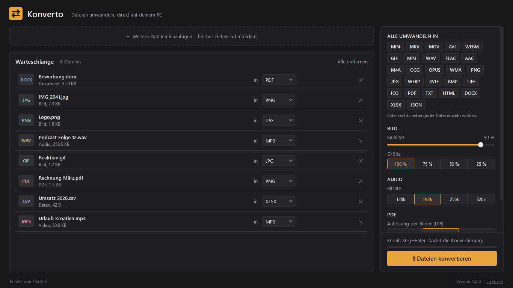

# Konverto – lokaler Datei-Konverter für Windows

Desktop-App, die Dateien **komplett offline** umwandelt. Nichts wird hochgeladen.



## Starten

- **Fertige EXE:** `dist\Konverto\Konverto.exe` (kein Python nötig; den ganzen Ordner `dist\Konverto` mitnehmen)
- **Aus dem Quellcode:** Doppelklick auf `Konverto starten.bat` (richtet beim ersten Start alles ein)
- **EXE neu bauen:** `build_exe.bat`
- **Microsoft-Store-Paket (MSIX):** `build_store.bat` – Anleitung in [STORE.md](STORE.md)

Wichtig: Nur `dist\Konverto\Konverto.exe` starten. PyInstaller-Zwischenordner (`build\`) enthalten keine lauffähige App.

Dateien oder ganze Ordner einfach ins Fenster ziehen, Zielformat wählen, **Konvertieren** (oder `Strg+Enter`).
Mit `Strg+O` öffnet sich die Dateiauswahl. Man kann Dateien auch auf `Konverto.exe` ziehen.

## Unterstützte Formate

| Von | Nach |
|---|---|
| **Video** MP4, MKV, MOV, AVI, WEBM, FLV, WMV, M4V, MPEG, 3GP, TS | MP4, MKV, MOV, AVI, WEBM, GIF · Audio extrahieren: MP3, WAV, FLAC, AAC, M4A, OGG, OPUS, WMA |
| **Audio** MP3, WAV, FLAC, AAC, OGG, M4A, WMA, OPUS, AIFF, AMR | MP3, WAV, FLAC, AAC, M4A, OGG, OPUS, WMA |
| **Bild** PNG, JPG, WEBP, AVIF, HEIC (iPhone), BMP, GIF, TIFF, ICO, TGA | PNG, JPG, WEBP, AVIF, BMP, GIF, TIFF, ICO, PDF · animiertes GIF → MP4/WEBM |
| **PDF** | PNG, JPG (jede Seite), TXT, DOCX (Text), HTML |
| **Dokument** DOCX, TXT, MD, HTML | PDF, TXT, HTML, DOCX |
| **Daten** CSV, XLSX, JSON | CSV, XLSX, JSON |

**Extras:** mehrere Bilder/PDFs/Dokumente in **eine PDF zusammenfügen**, Bildqualität & -größe, Audio-Bitrate,
Videoqualität und max. Auflösung, PDF-DPI, eigener Ausgabeordner. Mehrere Dateien laufen parallel; Einstellungen werden gemerkt.

## Technik

Python · PySide6 (Qt) · FFmpeg (über `imageio-ffmpeg` mitgeliefert) · Pillow + pillow-heif · PyMuPDF · python-docx · openpyxl

```
konverto/
  app.py      Hauptfenster, Warteschlange, Hintergrund-Worker
  engine.py   alle Konvertierungen
  formats.py  welche Formate wohin gehen
  widgets.py  Drop-Zone, Dateizeilen, Chips, Toast, Logo
  theme.py    Farben & Stylesheet
```

## Selbst bauen

```bash
python -m venv .venv
.venv\Scripts\python -m pip install -r requirements.txt pyinstaller
.venv\Scripts\python Konverto.pyw          # starten
.venv\Scripts\python packaging\build.py    # EXE bauen (--msix für das Store-Paket)
```

Für das MSIX-Paket wird das Windows SDK benötigt (makeappx, makepri).

## Lizenz

Konverto wurde von **DerKeK** erstellt und ist freie Software unter der
[GNU Affero General Public License v3.0](LICENSE). Die gebündelten Bibliotheken und ihre Lizenzen
stehen in [THIRD_PARTY_NOTICES.txt](THIRD_PARTY_NOTICES.txt).

Hinweis: DOCX → PDF übernimmt Text, Überschriften, Fett/Kursiv und Tabellen – Bilder und komplexes Layout aus Word nicht.
PDF → DOCX extrahiert nur den Text.
